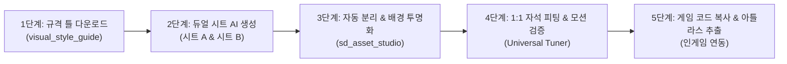

# 📘 1인 개발자를 위한 2D SD 모듈러 캐릭터 에셋 제작 공식 가이드 (SOP)
## Standard Operating Procedure: 0원 AI 기반 2D 게임 스프라이트 파이프라인

---

### 📌 개요
본 문서는 상용 2D 애니메이션 툴(Spine, Live2D)의 복잡한 라이선스와 공수를 대체하고, **순수 웹 기술(Canvas + CSS)과 생성형 AI(SD/Midjourney)**를 결합하여 완벽한 인게임 2D SD 모듈러 캐릭터 에셋을 제작하는 표준 실무 운영 절차(SOP)입니다.

---

## 🚀 제작 5단계 워크플로우 (Quick Overview)

---

## 🛠️ 단계별 상세 실무 지침

### 1단계: 종족/등급별 규격 틀 획득 (Template Download)
1. 브라우저에서 `visual_style_guide.html` 접속.
2. 상단 셀렉터에서 제작할 캐릭터의 **종족(인간, 수인, 숲, 비행, 땅, 변이)**과 **등급(C~UR, U)** 선택.
3. 생성 모드를 **`⭐ 2-A단계 소체 시트`** 및 **`⭐ 2-B단계 장비/표정 시트`**로 전환.
4. **`[📥 2-A 규격 틀 (PNG 2048x1152) 다운로드]`** 및 **`[📥 2-B 규격 틀 (PNG 2048x1152) 다운로드]`** 클릭하여 2장의 네온 그린 템플릿 PNG 파일 저장.

---

### 2단계: 나노바나나 / AI 이미지 생성 (2-Image Multi-Ref Generation)
생성형 AI(NanoBanana, Stable Diffusion WebUI ControlNet 등)에서 반드시 **2장의 이미지를 첨부**하고 프롬프트를 전송합니다:

#### [시트 A: 3면도 & 기본 체형 소체 생성]
* **첨부 이미지**:
  - Image 1: 원본 8등신 캐릭터 전신 일러스트
  - Image 2: 다운로드한 `[시트 A] 규격 틀 (PNG)`
* **프롬프트**: `visual_style_guide.html`의 **`[📋 2-A단계 소체 시트 합성 프롬프트 복사]`** 버튼 클릭 후 붙여넣기.
* **핵심 검증 포인트**:
  - `04. 기본 체형`이 옷과 속옷이 완전히 탈의된 **순수 매끄러운 피부의 소체**인가?
  - `01. 정면`과 `04. 기본 체형`의 **고개 각도와 골반 방향이 100% 동일한 정면 축**을 유지하는가?

#### [시트 B: 10슬롯 모듈러 장비 & 표정 팩 생성]
* **첨부 이미지**:
  - Image 1: 원본 8등신 캐릭터 전신 일러스트
  - Image 2: 다운로드한 `[시트 B] 규격 틀 (PNG)`
* **프롬프트**: `visual_style_guide.html`의 **`[📋 2-B단계 장비/표정 시트 합성 프롬프트 복사]`** 버튼 클릭 후 붙여넣기.
* **핵심 검증 포인트**:
  - `10. 상의`와 `11. 하의`에 **인체 피부(살점)가 0%인 순수 Hollow Shell**로 나왔는가?
  - `12. 날개`가 좌/우 결합형이 아닌 **단일 1짝(Single Left Wing)**으로 그려졌는가?
  - 표정이 위아래 두 줄이 아닌 **단일 가로 1행(05~08)**으로 정렬되었는가?

---

### 3단계: 스튜디오 업로드 및 원클릭 슬라이싱 (Auto Slice & Transparency)
1. 브라우저에서 `sd_asset_studio.html` 접속.
2. 좌측 패널 상단의 **`[⭐ 듀얼 시트(2-A 소체 + 2-B 장비) 업로드 모드]`** 클릭.
3. **슬롯 A**에 생성된 `시트 A` 드롭, **슬롯 B**에 생성된 `시트 B` 드롭.
4. 드롭 즉시 캔버스 엔진이 **#00FF00 크로마키 배경을 자동 투명화(Flood-Fill)**하고 10개 핵심 슬롯으로 자동 분리 슬라이싱 수행.
5. 하단 STEP 4에서 **`[✂️ 알맹이 픽셀 자동 밀착 (Auto-Trim)]`** 버튼을 눌러 여백을 칼같이 제거.

---

### 4단계: 실시간 1:1 피팅 & 무기 모션 검증 (Universal Rig Tuner)
1. **소체 시선 방향 일치**:
   - 만약 소체와 장비의 시선 방향이 반대라면, STEP 4 카드에서 **`[↔️ 반전]`** 버튼을 클릭하여 방향을 즉시 일치시킵니다.
2. **대표 지휘관 프리셋 선택**:
   - 상단에서 제작 중인 캐릭터(예: `🏹 핑크 레인저`, `🛡️ 티타니아` 등)를 선택하여 기본 최적 핏 자동 주입.
3. **전 파츠 1:1 피팅 튜너로 미세 조정**:
   - `[10. 복장 : 상의]` 선택 ➡️ `X 오프셋`을 조절하여 소체 흉부에 자석처럼 피팅.
   - `[11. 복장 : 하의]` 선택 ➡️ `X / Y 오프셋`을 조절하여 골반 라인 밀착.
   - `[05/08. 표정]` 선택 ➡️ `크기(Scale)` 및 `타원 마스크 반경` 조절.
4. **무기 모션 선택**:
   - 캐릭터 무기군에 맞춰 **`🏹 활 조준 사격`, `🔫 석궁 반동 격발`, `⚔️ 근접 무기 베기`, `🪄 마법 집중 방출`** 중 선택 후 클릭하여 공격 모션 검증!

---

### 5단계: 인게임 연동 및 파라미터 복사 (Game Integration)
1. **설정 코드 복사**:
   - 튜너 패널의 **`[📋 전체 핏 코드 복사]`** 클릭.
   - 복사된 JSON 코드를 인게임 `js/constants.js`의 지휘관 프로필 내 `modularCustomFit` 항목에 붙여넣기.
2. **에셋 저장**:
   - **`[📥 보유 파츠('없음' 제외) 일괄 다운로드]`** 클릭 ➡️ `assets/parts/` 폴더에 일괄 저장.
   - 인게임 전투 및 로비 보좌관 뷰에서 캐릭터의 완벽한 2D 모듈러 리깅 동작 확인!

---

## ⚠️ 실무 트러블슈팅 가이드

| 발생 현상 | 원인 분석 | 즉각 해결 방법 |
| :--- | :--- | :--- |
| **상의가 가슴보다 오른쪽으로 밀림** | 포니테일 등으로 소체의 중심선이 46%로 치우침 | 튜너에서 `10. 복장 : 상의` 선택 후 `X 오프셋`을 -2% ~ -4%로 좌측 이동. |
| **소체는 왼쪽을 보는데 옷은 오른쪽을 봄** | AI 생성 시 소체와 장비의 반측면 시선 방향 불일치 | STEP 4 해당 파츠 카드 하단의 **`[↔️ 반전]`** 버튼을 클릭하여 수평 반전. |
| **활을 쥐고 있는데 칼처럼 휘두름** | 무기 공격 모션이 근접 베기로 고정됨 | 시뮬레이터 상단 **[🏹 모션]** 드롭다운에서 `🏹 활 조준 사격 (Bow Sniping)`으로 변경. |
| **의상 파츠에 인체 살점이 묻어남** | 프롬프트의 Hollow Garment 규칙 누락 | 시트 B 프롬프트의 `HOLLOW GHOST GARMENT MANDATE (ZERO body flesh)` 지시어 적용 후 재출력. |

